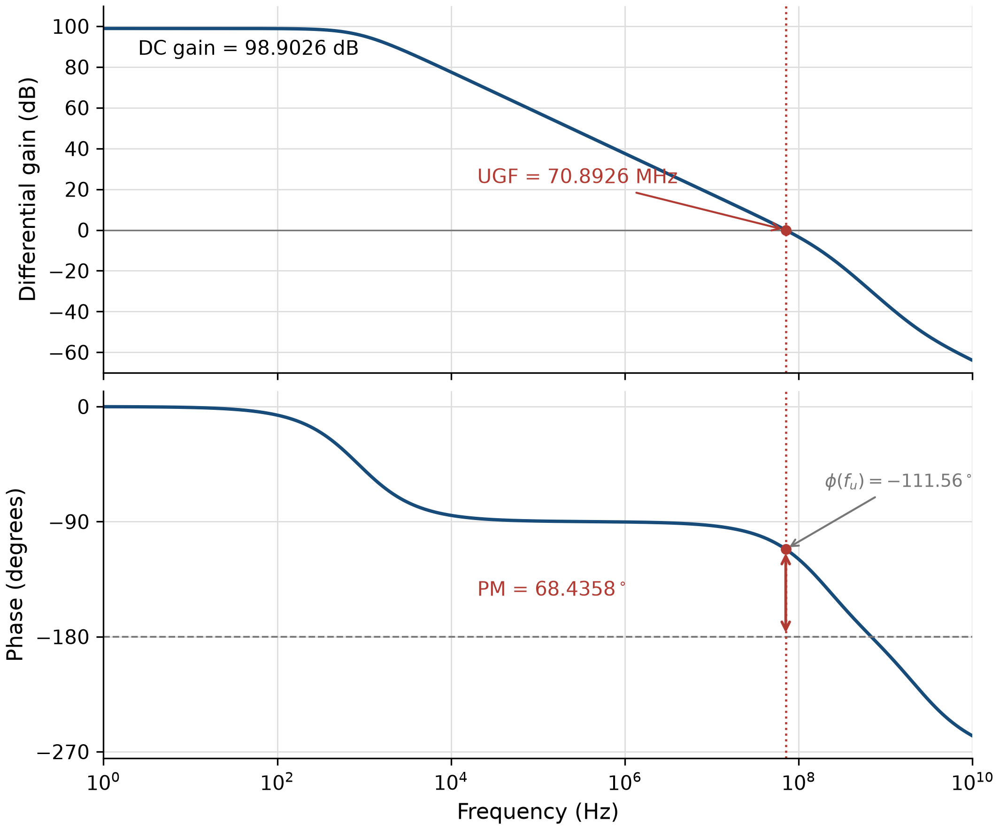

# Analog & Mixed-Signal Circuit Design Studies

Transistor-level amplifier design, bias calibration, and simulation analysis—from common-source and source-follower stages to a telescopic cascode OTA.

This portfolio collects coursework-based circuit studies. It emphasizes operating-point checks, explicit measurement conventions, and the engineering decisions behind the final design. The circuits shown here are analog blocks studied within analog and mixed-signal courses.

## Featured: Telescopic Cascode OTA

A gm/Id-guided, eleven-transistor differential amplifier with cascode loads and current-mirror biasing.

| Metric | Archived simulation | Design target |
|---|---:|---:|
| Low-frequency differential gain | 98.9026 dB | >95 dB |
| Unity-gain frequency | 70.8926 MHz | >70 MHz |
| Differential unity-feedback phase margin | 68.4358° | >64° |
| Open-loop −3 dB bandwidth | 852.7076 Hz | — |

Conditions: HSPICE R-2020.12 (reported), TT, 25 °C, 5 V supply, 2.5 V input common mode, 1 pF at each output. All eleven devices are recorded as saturated in the archived operating-point export.



[Design and tradeoffs](studies/telescopic-ota/README.md) · [AC samples](studies/telescopic-ota/ac_response.csv) · [Archived evidence](studies/telescopic-ota/evidence.json)

## CMOS Amplifier Comparison

Common-source and source-follower studies using C18 and ADFP models. The design process includes calibrated bias points, operating-region checks, load conventions, and gain/bandwidth tradeoffs.

[Read the case study](studies/cmos-amplifiers/README.md) · [Circuit decks](studies/cmos-amplifiers/netlists)

## Reproduce the saved-data analysis

Python 3, standard library only:

```sh
python3 scripts/analyze_ota.py
```

This recomputes the unity crossing and phase margin from the 1001 saved AC points and checks the archived device-region records. It does not run a circuit simulator. Circuit simulation requires a compatible HSPICE installation and separately obtained model libraries; process models are not distributed here.

## Scope and provenance

Results are nominal circuit simulations, not silicon measurements. PVT coverage, Monte Carlo mismatch, extracted-layout performance, common-mode feedback stability, and large-signal settling are not established by this portfolio. The OTA source decks referenced by the older report are unavailable in the current local archive, so its saved-data analysis is reproducible while a full OTA rerun package remains incomplete. ADFP circuit decks were reconstructed from user-run settings; they have not been independently rerun locally.

The work originates in analog and mixed-signal coursework. Standard circuit topologies are identified as such; the portfolio presents sizing, biasing, iteration, and analysis. AI assisted with documentation, organization, and analysis preparation; it is not an independent validation of simulator results.
